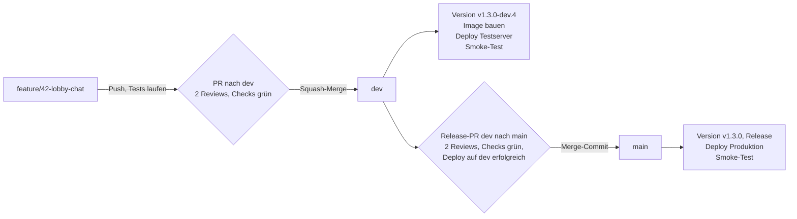
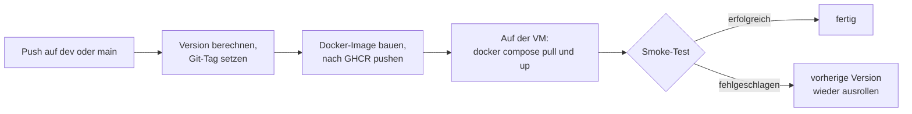

# Cloud-Labyrinth: GitHub- und CI/CD-Konzept

Dieses Dokument beschreibt, wie wir die beiden Repositories `cloud-labyrinth-server` und `cloud-labyrinth-client` in der Organisation `WS-2026-Cloud-Application-Project` auf GitHub einrichten. Es geht um Branches, Reviews, Tests, Versionierung und den automatischen Deploy auf unsere CloudStack-Server.

Stand: 04.11.2026, Vorschlag zur Abstimmung im Team

## Inhalt

1. [Ausgangslage](#1-ausgangslage)
2. [Ablauf einer Änderung](#2-ablauf-einer-änderung)
3. [Repo-Einstellungen](#3-repo-einstellungen)
4. [Branch-Schutz](#4-branch-schutz)
5. [Tests und Checks](#5-tests-und-checks)
6. [Versionierung](#6-versionierung)
7. [Deploy](#7-deploy)
8. [Vergleich mit Schedulify](#8-vergleich-mit-schedulify)
9. [Aufgaben vor dem Start](#9-aufgaben-vor-dem-start)
10. [Offene Entscheidungen](#10-offene-entscheidungen)
11. [Arbeitsregeln im Team](#11-arbeitsregeln-im-team)

## 1. Ausgangslage

### Anforderungen aus der Projektbeschreibung

Das Projekt läuft in drei Stufen auf Apache CloudStack: zuerst eine VM, dann Container mit CI/CD und Monitoring, zuletzt Skalierung über mehrere Instanzen. Für dieses Konzept sind vor allem zwei Systemziele relevant:

* **Ziel 7, kontrolliert ausgeliefert:** automatisch getestet, über Staging nach Produktion. Das entspricht unserem Modell mit `dev` als Testserver und `main` als Produktivserver.
* **Ziel 5, sicher:** keine Secrets im Repository, Sicherheitslücken früh erkennen.

### Unsere Vorgaben

* 5 Personen arbeiten mit
* zwei Repositories: Server und Client
* jedes Feature in einem eigenen Branch, Tests laufen schon beim Push
* jeder Pull Request braucht mindestens 2 Reviews von anderen Teammitgliedern
* Merge immer zuerst nach `dev`, von dort nach `main`
* bei jedem Merge nach `dev` oder `main` ändert sich die Versionsnummer
* Deploy auf die Server läuft automatisch

### Aktueller Stand der Repositories

| | Server | Client |
|---|---|---|
| Technologie | Spring Boot 3.5, WebSocket, Java 17 | JavaFX 21 Desktop-App, Java 17 |
| Quellcode | im Ordner `app/` | im Ordner `app/` |
| Branches | nur `main` | nur `main` |
| Rulesets, Environments, Workflows | keine | keine |
| Maven Wrapper | vorhanden | fehlt |
| Health-Endpoint | fehlt (kein Actuator) | nicht relevant |
| Tests | Unit-Tests | Unit-Tests und TestFX-Tests |

Zwei Punkte, die wir vorab klären sollten:

* Aktuell sind alle 5 Mitglieder Owner der Organisation. Damit kann jede Person die Schutzregeln deaktivieren. Vorschlag: 1 bis 2 Owner, alle anderen in einem Team mit der Rolle Maintain.
* Die Workflows aus dem alten Repository `AIP-Labyrinth-Group3` haben nur kompiliert und keine Tests ausgeführt. Wir setzen die Pipelines neu auf.

## 2. Ablauf einer Änderung



1. Neuen Branch von `dev` erstellen, z. B. `feature/42-lobby-chat`.
2. Entwickeln und pushen. Bei jedem Push laufen Build, Unit-Tests und Codestyle-Prüfung.
3. Pull Request nach `dev` öffnen. Zusätzlich laufen Integrationstests und Sicherheitsprüfungen.
4. Zwei andere Teammitglieder reviewen und geben frei.
5. Squash-Merge nach `dev`. Die CI vergibt eine neue dev-Version und deployt auf den Testserver.
6. Wenn der Stand auf dem Testserver passt: Release-PR von `dev` nach `main`, wieder mit 2 Reviews.
7. Merge nach `main`. Die CI vergibt die Release-Version und deployt in Produktion.

## 3. Repo-Einstellungen

Die folgenden Einstellungen gelten für beide Repositories.

| Einstellung | Wert | Begründung |
|---|---|---|
| Default-Branch | `dev` | PRs zeigen automatisch auf `dev`, neue Klone starten auf `dev` |
| Merge-Methoden | Squash und Merge-Commit erlaubt, Rebase aus | welche Methode wo gilt, legt das Ruleset fest |
| Commit-Message beim Squash | PR-Titel | der PR-Titel bestimmt die Versionsnummer |
| Head-Branches nach Merge löschen | an | `dev` ist durch das Ruleset vor dem Löschen geschützt |
| Secret Scanning mit Push Protection | an | Pushes mit API-Keys werden blockiert |
| Dependabot | an, Ziel-Branch `dev` | Updates für Maven, Docker und Actions |
| CodeQL | an | statische Sicherheitsanalyse, für öffentliche Repos kostenlos |
| Rechte des `GITHUB_TOKEN` | standardmäßig nur lesen | Jobs bekommen nur die Rechte, die sie brauchen |
| Workflows aus Forks | Freigabe erforderlich | Schutz, weil die Repos öffentlich sind |

### Branch-Namen

| Präfix | Verwendung | Beispiel |
|---|---|---|
| `feature/` | neue Funktion | `feature/42-lobby-chat` |
| `fix/` | Fehlerbehebung | `fix/57-rotation-bug` |
| `chore/` | Build, CI, Abhängigkeiten | `chore/maven-wrapper` |
| `docs/` | Dokumentation | `docs/deploy-anleitung` |

### Dateien im Repository

```text
.github/
├── workflows/
│   ├── ci.yml               jeder Push: Build, Unit-Tests, Codestyle, Coverage
│   ├── pr-checks.yml        jeder PR: Integrationstests, Sicherheit, PR-Titel, Quell-Branch
│   ├── codeql.yml           Sicherheitsanalyse
│   └── release-deploy.yml   Push auf dev oder main: Version, Image, Deploy, Smoke-Test
├── dependabot.yml
├── pull_request_template.md
└── CODEOWNERS               z. B. .github/ gehört der Person mit der DevOps-Rolle
```

## 4. Branch-Schutz

Der Schutz wird über GitHub Rulesets eingerichtet. Rulesets gelten auch für Admins, die Liste der Ausnahmen bleibt leer.

| Regel | `dev` | `main` |
|---|---|---|
| Pull Request erforderlich | ja | ja |
| Anzahl Approvals | 2 | 2 |
| Approvals verfallen bei neuem Push | ja | ja |
| Letzter Push muss von einer anderen Person freigegeben werden | ja | ja |
| Alle Review-Kommentare aufgelöst | ja | ja |
| Erlaubte Merge-Methode | Squash | Merge-Commit |
| Pflicht-Checks grün | ja | ja |
| Branch muss auf aktuellem Stand sein | ja | ja |
| Nur PRs aus `dev` erlaubt | nein | ja |
| Erfolgreicher Deploy auf `development` nötig | nein | ja |
| Löschen und Force-Push blockiert | ja | ja |

Erläuterungen:

* **Squash nach `dev`:** Jedes Feature landet als ein Commit in `dev`, die Commit-Message ist der PR-Titel.
* **Merge-Commit nach `main`:** Mit Squash würden `dev` und `main` auseinanderlaufen, und der nächste Release-PR würde alte Änderungen erneut anzeigen.
* **Nur PRs aus `dev`:** GitHub bietet dafür keine eigene Regel. Ein kleiner Check im Workflow schlägt fehl, wenn der Quell-Branch nicht `dev` ist, und ist als Pflicht-Check eingetragen.
* **Erfolgreicher Deploy auf `development`:** Diese Regel gibt es direkt im Ruleset. Nach `main` kommt damit nur Code, der vorher auf dem Testserver gelaufen ist.

### Pflicht-Checks

| Check | `dev` | `main` |
|---|---|---|
| Build und Unit-Tests | ja | ja |
| Integrationstests | ja | ja |
| PR-Titel nach Conventional Commits | ja | ja |
| Secret-Scan (gitleaks) | ja | ja |
| CodeQL | ja | ja |
| Docker-Build mit Healthcheck | ja | ja |
| Quell-Branch ist `dev` | nein | ja |

## 5. Tests und Checks

### Bei jedem Push

Diese Prüfungen sollen in unter 5 Minuten durchlaufen.

| Prüfung | Server | Client | Werkzeug |
|---|---|---|---|
| Kompilieren und Unit-Tests | ja | ja | `./mvnw verify` |
| Codestyle (Namen, ungenutzte Imports) | ja | ja | Checkstyle nach `CODESTYLE.md` |
| Testabdeckung, z. B. mindestens 60 % in `domain/` | ja | ja | JaCoCo |
| UI-Tests ohne Bildschirm | nein | ja | TestFX mit Monocle |

### Zusätzlich bei jedem Pull Request

| Prüfung | Inhalt |
|---|---|
| WebSocket-Integrationstest (Server) | Der Server startet vollständig (`@SpringBootTest`), die Server-Registry wird mit WireMock simuliert. Zwei Test-Clients spielen Verbindung, Lobby, Spielstart und einen Zug durch. |
| Contract-Test | Die JSON-Nachrichten entsprechen dem Schema aus `labyrinth-interface`. |
| Client gegen Server | Die Client-Tests laufen gegen den echten Server-Container mit dem aktuellen `dev`-Image. |
| Docker-Build | Image wird gebaut und gestartet, Healthcheck ist grün, Trivy findet keine kritischen Lücken. |
| Secret-Scan | gitleaks findet keine Schlüssel oder Passwörter. |
| Dependency-Review | Neue Bibliotheken haben keine bekannten Sicherheitslücken. |
| CodeQL | Statische Sicherheitsanalyse für Java. |
| PR-Titel | Der Titel beginnt mit `feat:`, `fix:`, `chore:` usw. |

### Nach jedem Deploy

* Smoke-Test auf Test- und Produktivserver: `/actuator/health` meldet `UP`, eine WebSocket-Verbindung auf `/game` bekommt eine Antwort.
* Schlägt der Smoke-Test fehl, wird automatisch die vorherige Version wieder ausgerollt.

### Für Stufe 2 und 3

* Nächtlicher Lasttest mit k6 gegen den Testserver, als Nachweis für das Ziel „performant“.

## 6. Versionierung

Wir verwenden Semantic Versioning. Die Version wird aus den PR-Titeln berechnet und von der CI als Git-Tag gesetzt. Es wird dabei nichts auf `dev` oder `main` committet, deshalb braucht die CI keine Ausnahme im Branch-Schutz.

| Ereignis | neue Version | auf GitHub |
|---|---|---|
| Merge nach `dev` | `v1.3.0-dev.4` | Pre-Release |
| Merge nach `main` | `v1.3.0` | Release mit automatisch erzeugten Release-Notes |

### Welche Stelle erhöht wird

| PR-Titel beginnt mit | Beispiel | Version |
|---|---|---|
| `fix:` | `fix: Rotation der Extra-Karte` | 1.2.3 wird 1.2.4 |
| `feat:` | `feat: Chat in der Lobby` | 1.2.3 wird 1.3.0 |
| `feat!:` oder `BREAKING CHANGE` | `feat!: neues Nachrichtenformat` | 1.2.3 wird 2.0.0 |
| `chore:`, `docs:`, `test:` | `docs: README aktualisiert` | nur der dev-Zähler steigt |

### Umsetzung

* In der `pom.xml` steht `<version>${revision}</version>`. Die CI baut mit `-Drevision=1.3.0-dev.4`.
* Der Server liest seine Version mit `server.version=@project.version@` aus dem Build statt aus einem festen Wert.
* Das Docker-Image bekommt dieselbe Version als Tag.
* Server und Client haben getrennte Versionsnummern. Ob sie zusammenpassen, regelt die `protocol.version`.

Nicht gewählt haben wir einen Versions-Commit in die `pom.xml` (z. B. mit release-please). Dafür bräuchte die CI eine Ausnahme im Branch-Schutz, oder jeder Versionswechsel wäre ein eigener PR mit 2 Reviews.

## 7. Deploy

### Umgebungen

| GitHub Environment | Branch | Ziel | Secrets (Beispiele) |
|---|---|---|---|
| `development` | nur `dev` | Testserver (CloudStack-VM) | SSH-Schlüssel und Host, `OPENAI_API_KEY`, Registry-URL |
| `production` | nur `main` | Produktivserver (CloudStack-VM) | SSH-Schlüssel und Host, `OPENAI_API_KEY`, Registry-URL |

Die Secrets liegen nur in GitHub. Der Deploy-Job schreibt daraus beim Ausrollen die `.env`-Datei auf der VM.

### Ablauf beim Server



* Wir verwenden schon in Stufe 1 Container. Dann bleibt die Pipeline für Stufe 2 und 3 gleich.
* Beispiel für ein Image: `ghcr.io/ws-2026-cloud-application-project/cloud-labyrinth-server:1.3.0-dev.4`
* Der Server-Port wird über eine Umgebungsvariable fest gesetzt, statt dynamisch zwischen 8397 und 8405 gewählt.
* Test- und Produktivserver bekommen unterschiedliche Namen bzw. MOTD, damit man sie in der Server-Registry unterscheiden kann.

### Verbindung von GitHub zu den VMs

Wie GitHub die VMs erreicht, ist noch offen. Es gibt zwei Möglichkeiten:

| | Variante A: SSH | Variante B: Self-hosted Runner |
|---|---|---|
| Voraussetzung | VM hat öffentliche IP und SSH-Port-Forwarding in CloudStack | VM braucht nur ausgehenden Internetzugang |
| Funktionsweise | ein Runner von GitHub verbindet sich per SSH zur VM | ein Runner läuft auf der VM und holt Jobs von GitHub ab |
| Vorteil | einfach, auf der VM wird nichts installiert | keine offenen Ports nötig |
| Einschränkung | SSH-Port ist von außen erreichbar | darf nur Deploy-Jobs nach einem Push ausführen, nie Jobs aus PRs, weil die Repos öffentlich sind |

### Client

Der Client ist eine Desktop-Anwendung und läuft nicht auf dem Server. Deploy bedeutet beim Client:

* Die CI baut ausführbare Pakete für Windows, macOS und Linux (Jar bzw. jpackage).
* Die Pakete werden an den GitHub-Release (`main`) bzw. Pre-Release (`dev`) angehängt.
* Builds aus `dev` verbinden sich standardmäßig mit dem Testserver.

## 8. Vergleich mit Schedulify

Schedulify ist ein bestehendes Projekt mit demselben Modell aus `dev` und `main`. Einiges davon übernehmen wir, anderes setzen wir strenger um.

| Thema | Schedulify | Cloud-Labyrinth |
|---|---|---|
| Branch-Modell | feature, dann `dev`, dann `main` | gleich |
| Default-Branch | `main`, dadurch wird oft vom falschen Branch abgezweigt | `dev` |
| Branch-Schutz | nur Löschen und Force-Push blockiert | zusätzlich PR-Pflicht, 2 Reviews, Pflicht-Checks |
| Reviews | nicht verpflichtend | 2 Approvals |
| CI | keine, Tests laufen nur lokal | GitHub Actions bei jedem Push |
| Deploy | Coolify deployt bei jedem Push, unabhängig von den Tests | Deploy erst nach erfolgreichen Tests, danach Smoke-Test |
| Versionierung | keine, nur Commit-Hash | SemVer-Tags, automatisch |
| Merge-Strategie | überall Merge-Commits | Squash nach `dev`, Merge-Commit nach `main` |
| Secrets | in Coolify, von dort in die `.env` | in GitHub Environments, von dort in die `.env` |

**Übernommen aus Schedulify:** das Modell mit `dev` und `main`, Commit-Messages nach Conventional Commits, `.env.example` statt echter Secrets im Repo, docker-compose mit Healthchecks, Container laufen ohne Root-Rechte, jede Änderung enthält ihre Tests.

**Anders als bei Schedulify:** Es wird nur deployt, wenn alle Tests erfolgreich waren. Das verlangt Systemziel 7.

## 9. Aufgaben vor dem Start

### Server

- [ ] Spring Boot Actuator einbauen (`/actuator/health`)
- [ ] Port über Umgebungsvariable fest einstellbar machen
- [ ] `server.version` aus der `pom.xml` übernehmen (`@project.version@`)
- [ ] `pom.xml` auf `${revision}` umstellen
- [ ] `Dockerfile` und `docker-compose.yml` anlegen
- [ ] Checkstyle und JaCoCo in die `pom.xml` aufnehmen

### Client

- [ ] Maven Wrapper (`mvnw`) hinzufügen
- [ ] doppelte JUnit- und Mockito-Abhängigkeiten mit unterschiedlichen Versionen bereinigen
- [ ] TestFX ohne Bildschirm (Monocle) konfigurieren
- [ ] Server-URL pro Umgebung konfigurierbar machen

### Beide Repositories

- [ ] Branch `dev` anlegen und als Default-Branch setzen
- [ ] Rulesets für `dev` und `main` einrichten
- [ ] Environments `development` und `production` mit Secrets anlegen
- [ ] Workflows, `dependabot.yml`, PR-Template und `CODEOWNERS` hinzufügen
- [ ] Build-Badges in der README auf die neue Organisation umstellen
- [ ] `.env.example` korrigieren, dort steht noch ein Verweis auf `ENV_TEMPLATE`

### Organisation

- [ ] Rollen festlegen: 1 bis 2 Owner, alle anderen im Team mit Rolle Maintain
- [ ] festlegen, wer die DevOps-Rolle übernimmt (Eintrag in `CODEOWNERS` für `.github/`)

## 10. Offene Entscheidungen

| Nr. | Frage | Möglichkeiten |
|---|---|---|
| 1 | Wie erreicht GitHub die CloudStack-VMs? | A: SSH über öffentliche IP, B: Self-hosted Runner |
| 2 | Braucht der Deploy in Produktion zusätzlich eine manuelle Freigabe? | nein, vollautomatisch; oder ja, eine Person gibt frei |
| 3 | Welche Mindest-Testabdeckung setzen wir? | z. B. 60 % in `domain/`, später erhöhen |
| 4 | Wer sind die 1 bis 2 Owner der Organisation? | offen |

## 11. Arbeitsregeln im Team

1. Nie direkt auf `dev` oder `main` arbeiten, immer in einem eigenen Branch, der von `dev` abzweigt.
2. PR-Titel im Format `feat: ...`, `fix: ...` oder `chore: ...` schreiben, weil der Titel die Version bestimmt.
3. Jede Änderung enthält ihre Tests. Bei einem Bugfix gehört ein Test dazu, der ohne den Fix fehlschlägt.
4. Reviews zeitnah erledigen. Jeder PR braucht 2 Approvals, das klappt nur, wenn alle mitreviewen.
5. Den eigenen Branch aktuell halten und `dev` regelmäßig hineinmergen.
6. Keine Secrets committen. Im Repo liegt nur `.env.example`, die echten Werte sind in GitHub hinterlegt.
7. Nach `main` wird nur per PR aus `dev` gemergt, und erst wenn der Testserver stabil läuft.
